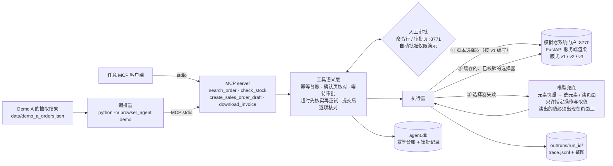

# 浏览器 Agent + MCP：没有 API 的老系统也能录单/查单

> **演示数据均为虚构，不代表任何真实客户项目。** 分销商「瑞丰机电批发（虚构）」、8 家客户、300 个 SKU、订单和发票全部为生成数据，
> 与「订单邮件 → ERP 智能录单」演示（下称 Demo A）用的是同一套主数据。被自动化的“老系统”是本项目自己写的模拟门户，从不操作任何真实的第三方网站。

很多企业的 ERP、供应商门户是十几年前的网页系统，没有 API，录单、查单、下载发票只能靠人点。这个项目把这样一个系统包装成 4 个 **MCP 工具**，
任何支持 MCP 的客户端（桌面 AI 助手、IDE 插件、Dify 之类的编排平台，或你自己的 Python 脚本）都能调用：

- `search_order` 查单、`check_stock` 查库存、`download_invoice` 下载发票 PDF —— 只读；
- `create_sales_order_draft` 新建销售订单草稿 —— **写操作，必须人工批准**，带幂等键，提交后回到门户核实才算成功。

每个工具先走写死的 Playwright 脚本（快、零成本）；界面改版导致选择器失效时，才把页面的可操作元素列表交给大模型（DeepSeek / 通义千问，
OpenAI 兼容接口）定位元素，模型能做的事被代码限制在白名单内。每次调用都留下截图和 JSONL 轨迹。

## 架构



## 快速开始

需要 Python 3.10+（开发环境为 Python 3.15 / Windows 11）。没有 Node.js、没有 n8n：编排用 Python 写。

```powershell
pip install -r requirements.txt
python -m playwright install chromium          # 已装过可跳过；装在别处时设置 PLAYWRIGHT_BROWSERS_PATH

python -m browser_agent portal --fresh          # 终端 1：模拟老系统 http://127.0.0.1:8770 （账号见 .env.example）
python -m browser_agent demo                     # 终端 2：Demo A 的 3 张订单 → MCP 工具 → 命令行逐单审批 → 提交 → 核实
python -m browser_agent demo --auto-approve      # 演示用：自动批准
python -m browser_agent eval                     # 评测（没有 key 时模型列用录好的真实调用回放，零费用）
python -m unittest discover -s tests -t .        # 40 个测试（含真实 Chromium 的浏览器测试，约 70 秒）
```

| 命令 | 作用 |
|---|---|
| `python -m browser_agent portal [--fresh] [--layout v1\|v2\|v3]` | 启动模拟门户（127.0.0.1:8770）；`/admin/settings` 是演示控制页：切换界面版本，注入“提交后卡顿 N 秒”或“卡顿后丢失”故障 |
| `python -m browser_agent mcp` | 以 stdio 方式运行 MCP server；同时在 127.0.0.1:8771 启动写操作审批页（`APPROVAL_WEB=0` 可关闭） |
| `python -m browser_agent demo [--approve cli\|web\|auto] [--layout v2] [--limit N]` | 端到端演示；门户没在运行时会在进程内自动启动一个。`--auto-approve` 等同 `--approve auto` |
| `python -m browser_agent eval [--configs ...]` | 评测；可选 `scripted,model,holdout_scripted,holdout_model,naive_retry`，默认全部 |
| `python -m browser_agent approvals` | 单独启动审批页 |
| `python tools/make_data.py` | 重新生成门户种子数据和 20 个评测任务（固定随机种子） |

`out/` 里的产出：`portal.db`（门户数据）、`agent.db`（幂等台账和审批记录）、`selector_cache.json`（模型找到并校验过的选择器）、
`runs/<run_id>/`（每次工具调用的 `trace.jsonl` 和截图）、`downloads/`（发票 PDF）、`eval/<配置>/`（评测时的独立环境）。

## 四个 MCP 工具

| 工具 | 参数 | 返回 |
|---|---|---|
| `search_order` | `order_no` / `customer_po` / `customer_id` / `date_from` / `date_to`，`max_pages`（默认 5） | 订单行列表（自动翻页）、读了几页 |
| `check_stock` | `skus`（1–20 个） | 每个料号的现存量、可用量、状态；不存在的放进 `not_found` |
| `create_sales_order_draft` | `order`（客户、客户单号、日期、明细行）、可选 `idempotency_key` | `created` / `already_exists` / `rejected` / `approval_timeout` / `portal_rejected` / `conflict` / `needs_human` / `unverified`，以及门户单号 |
| `download_invoice` | `order_no` | `ok`（PDF 路径 + 从 PDF 文字层解析出的发票号、金额）/ `no_invoice` / `not_found` |

每个返回都带 `run`：轨迹文件、截图列表、耗时，以及这次调用里脚本步骤、缓存步骤、模型步骤和模型调用各多少次。

### 在任意 MCP 客户端里注册

在客户端的 MCP 配置（例如 Claude Desktop、Cursor 一类客户端的 `mcpServers` 段）里加入下面这段，路径换成本项目目录，
完整示例见 `mcp_client_config.example.json`。不填 `LLM_API_KEY` 时只走脚本，选择器失效就转人工。

```json
{
  "mcpServers": {
    "legacy-portal": {
      "command": "python",
      "args": ["-m", "browser_agent", "mcp"],
      "cwd": "C:/path/to/browser_agent_demo",
      "env": { "PYTHONPATH": "C:/path/to/browser_agent_demo", "PORTAL_URL": "http://127.0.0.1:8770" }
    }
  }
}
```

调用写工具时，客户端会一直等到有人在审批页 http://127.0.0.1:8771 上批准或驳回（默认最多 300 秒）；超时返回 `approval_timeout`、
什么都不提交，之后用同一个幂等键再调用即可接着走。MCP 里刻意**没有**“批准”工具：调用方的模型不能自己批准自己。

## 写操作的安全设计

1. **人工审批。** 表单填到门户的确认页就停下，截图交给审批人（命令行、审批页二选一，`--auto-approve` 仅供演示和评测）。
   审批之前，程序先把确认页上的明细和合计读回来，和订单逐行比对，不一致直接转人工，不会请人批准一张填错的单。
2. **幂等键。** 默认按订单内容生成（`ik-` + 内容哈希前 12 位），写进门户订单的“备注”。同一个键：本地台账已核实 → 直接返回原单号，不碰门户；
   台账丢了 → 先在门户里按客户单号搜出订单、打开详情看备注里有没有这个键；同键不同内容 → `conflict`；被驳回过 → 继续拒绝。
   这个老系统自己**没有**防重（测试里验证过：同一张单提交两次就是两张单）。
3. **超时先核实，再决定重试。** 点“提交”后 5 秒没回应，不重试，先去门户搜这个幂等键（最多 3 次、间隔 1 秒）；搜到就当成功，
   确认没有才重新填表再提交一次；还不行就返回 `unverified` 请人确认。
4. **提交后核对。** 拿到门户单号后打开这张单，核对备注里的幂等键、客户、客户单号、日期、每一行的物料/数量/单价和合计，全部一致才报告 `created`。
5. **证据。** 每次调用一个目录：`trace.jsonl` 记录每一步走的是脚本、缓存还是模型，模型返回的动作和理由，审批人和决定；
   关键页面（确认页、核对页、转人工时的页面、每次模型兜底前的页面）都有整页截图。密码在轨迹里记为 `***`。
6. **模型的边界（代码强制，不是只写在提示词里）。** 模型只能从元素快照里选 ref；点击类步骤只能点 1 次，填写类步骤最多 3 个动作（例如 年/月/日 三个下拉框）；
   填写或选择的值必须是这一步自己的值（日期允许换写法或拆分）；账号和密码以 `<secret>` 占位，**从不发给模型**；
   模型从页面上读出来的每个值都必须在页面原文里出现（数字按数值、日期按各种写法比对），否则带着错误重问一次，再不行就转人工；
   每次工具调用最多 60 次模型调用。模型找到的元素会算出一个 CSS 选择器缓存起来，下次先用缓存，但用之前要核对标签和类型没变。

## 评测结果（实测）

### 任务集

`data/eval_tasks.json`，由 `tools/make_data.py` 生成：10 类任务 × 2 个版式 = 20 个任务。T01–T10 在 **v1 经典版**上跑（脚本就是照它写的），
T11–T20 在 **v2 新版界面**上跑（菜单、字段名、元素 id/name、表格结构、按钮位置全变）。10 类任务：

| 类别 | 任务 | 判定（除工具返回外，还直接查门户数据库） |
|---|---|---|
| 查单 | 按客户单号查；按客户 + 日期范围查（结果 13 / 12 条，跨两页） | 单号集合完全一致 |
| 查库存 | 3 个料号，其中 1 个不存在 | 可用量一致，不存在的料号进 `not_found` |
| 发票 | 已开票订单下载 PDF；未开票订单 | 发票号、金额一致；未开票返回 `no_invoice` |
| 录单 | Demo A 订单，再用同一幂等键调用一次 | 第二次返回 `already_exists`，门户里只有 1 张 |
| 录单 | 多行订单（含箱装物料） | 门户里恰好 1 张，客户、单号、每行一致 |
| 录单 | 故障注入：提交后门户 8 秒才响应（订单其实已保存） | 返回 `created`，门户里恰好 1 张 |
| 录单 | 审批人驳回 | 返回 `rejected`，门户里 0 张 |
| 录单 | 订单含停用物料，门户校验报错 | 返回 `portal_rejected` 并带门户原话，门户里 0 张 |

**hold-out 版式 v3**（`browser_agent/portal/layout_v3.py`）在跑任何评测之前写好、跑完之后没有为它改过代理代码：老式 WebForms 风格，
整页一个表单用 `__doPostBack` 回发，标签在相邻单元格里，客户靠手输编码，单据日期是 年/月/日 三个下拉框，查询日期要写成 `yyyymmdd`，
抬头和明细在同一页、点“保存”后进入确认页，表格没有 `<thead>`、列顺序不同、金额带千分位、日期用点分隔，翻页是“首页/上页/下页/尾页/转到”。
用 T11–T20 的同一批任务。

### 结果

| 指标 | v1 · 仅脚本 | v2 · 仅脚本 | v1 · 脚本+模型 | v2 · 脚本+模型 | v3 hold-out · 仅脚本 | v3 hold-out · 脚本+模型 |
|---|---|---|---|---|---|---|
| 任务成功 | **10/10** | 0/10 | **10/10** | **10/10** | 0/10 | **10/10** |
| 每个任务耗时：平均（中位） | 1.8s（0.9s） | 1.9s（1.8s） | 1.8s（0.9s） | 20.3s（12.6s） | 2.0s（1.8s） | 21.0s（15.1s） |
| 需要人工处理的任务（其中非预期） | 1（0） | 10（9） | 1（0） | 1（0） | 10（9） | 1（0） |
| 门户里的重复提交 | **0** | 0 | **0** | **0** | 0 | **0** |
| 门户里写错的订单 | 0 | 0 | 0 | 0 | 0 | 0 |
| 用到模型的任务 / 模型调用次数 | 0 / 0 | — | 0 / 0 | 10 / 84 | — | 10 / 99 |

按 20 个任务（v1 + v2）合计：仅脚本 10/20，脚本 + 模型兜底 **20/20**，重复提交都是 0。

| 对照实验（`naive_retry`，T08，v1） | 结果 |
|---|---|
| 关掉“超时先核实”，超时后直接重新填表提交 | 门户里同一张单变成 **2 张** |

“需要人工处理”指工具返回 `needs_human` / `portal_rejected` / `unverified` / `approval_timeout`。每个版式里“订单含停用物料”那一题本来就该转人工，
记为预期；仅脚本在 v2、v3 上 10 题全部转人工，其中 9 题是非预期的。耗时不含人工审批的等待（评测里审批人是脚本）。

DeepSeek 列为 2026-11-18（UTC）用 `deepseek-flash` 实际调用的结果（`source: live`）。完整报告：`evaluation/scripted.md`、
`evaluation/model_live.md`、`evaluation/holdout_scripted.md`、`evaluation/holdout_model_live.md`、`evaluation/naive_retry.md`
（同名 `.json` 含逐任务明细和轨迹路径；轨迹本身在 `out/eval/` 下，运行评测时重新生成）。

怎么读这张表：

- **仅脚本**：v1 全对、不调用模型、平均 1.8 秒一个任务。界面一改（v2、v3），第一个找不到的选择器就停下转人工，10 个任务都没有完成，
  但门户里也没有写进任何东西——失败的方式是安全的。
- **脚本 + 模型兜底**：v1 上模型一次都没被调用；v2 和 v3 都是 10/10。代价是速度：v2 平均 20 秒一个任务，是 v1 的约 11 倍，大部分时间花在
  模型调用上（多数一次 1–2 秒）。第一次在新界面上录单（T16，5 行明细）要 33 次模型调用、约 1 分钟；之后同一界面的录单靠缓存下来的选择器，
  主要只剩“读页面”还需要模型（v2 上 T17 7 次、T19 3 次）。
- 84 次和 99 次模型调用全部一次就通过了代码校验（没有触发“带错误重问”）；其中 11 次和 16 次是模型如实回答“页面上没有这个元素”
  （已经是最后一页、第 4 行还不存在需要先增行、v3 的单页表单没有“下一步”）。
- 在 hold-out v3 上，模型把单据日期拆成 年/月/日 三个下拉框分别选择；看到查询日期框提示 `yyyymmdd` 就填 `20261001`；认出明细输入框就在本页、
  不需要点“下一步”；在确认页点“确 定”而不是“返回修改”。这些从轨迹里的 `reason` 字段可以逐条看到。
- **超时**：T08/T18 里门户保存后 8 秒才返回页面。程序 5 秒超时后先去门户搜这个幂等键，搜到就不再提交，门户里都只有 1 张。
  “门户卡住且没保存”的情况由单元测试覆盖：确认搜不到之后才重新填表提交一次，最后恰好 1 张。
- **一次测试集修正**：第一次真实运行时 T12 判为失败。查下来是答案写错了：同一轮里 T07 先建了一张 C004 的订单，日期正好落在 T12 的查询范围里，
  代理返回 13 条是对的，答案只写了 12 条。改为让 T07、T18 用 C001 的订单（见 `tools/make_data.py` 里的注释）、重新生成任务后，删掉旧的录制记录完整重跑了一次，
  表中是重跑的结果。那次运行其余 19 个任务也都成功。修正只改了任务数据，没有改代理代码。
- 回放复现时（`evaluation/*_replay.md`）成功数、模型调用次数与真实运行完全一致，耗时更短（v2、v3 平均约 8 秒），因为不用等模型接口。

### 费用（来自接口返回的 usage 字段）

| 运行 | 调用次数 | 输入 tokens | 输出 tokens |
|---|---|---|---|
| v1 + v2 评测（当前 `data/replay/` 对应的运行） | 84 | 67,486 | 11,934 |
| hold-out v3 评测 | 99 | 128,379 | 11,133 |
| 第一次 v1 + v2 评测（测试集修正前，记录已删除） | 83 | 66,503 | 8,868 |
| 开发调试（在 v2 上手动试跑） | 83 | 63,276 | 9,847 |
| 合计 | 349 | 325,644 | 41,782 |

DeepSeek 账户余额：本项目第一次调用前 4.91 美元，全部运行结束后 4.76 美元，约 0.15 美元（余额显示可能有延迟，是近似值）。
v3 的输入 tokens 明显更多，因为 WebForms 风格的元素名（`ctl00$cph$gvLines$ctl01$txtInv`）和页面文字更长。

### 不花钱复现模型列

真实调用的原始返回保存在 `data/replay/`（171 个文件、183 次调用 = 84 + 99；同一请求出现多次时追加在同一个文件里），
每个文件记录 `source: live`、`provider`、`model`，以及每次调用的 `recorded_at`（2026-11-18，UTC）、`usage` 和原始 `response`。

```powershell
$env:LLM_MODE="replay"; python -m browser_agent eval
```

不设置 `LLM_API_KEY` 时 `eval` 也会自动改用回放。回放只读取这些真实记录：找不到对应请求、或记录不是 `source: live` 时这一步直接转人工，不会编造结果。
请求的键是提示词全文的哈希，而提示词里有页面快照，所以只要门户页面或提示词有一个字变了，回放就会失效，需要重新录制。

## 局限（如实说明）

- **被自动化的是自己写的模拟门户**，没有在任何真实老系统上验证过。真实系统常见的验证码、iframe、浏览器插件/控件、`alert()` 弹窗、文件上传、
  会话超时被踢出、单点登录、并发锁，这里都没有。弹窗形式的报错目前识别不了（错误提示是按“红色文字或带 error 类名的元素”通用识别的）。
- **hold-out 不是真正的陌生系统。** v3 和代理是同一个人写的；更要紧的是，流程步骤里给模型看的意图带了三个版式的同义词
  （如“操作员代码”“现存量查询”“增行”“确定”“保存”），这些词是在 v3 写好之后编写流程时加入的。所以 v3 只能算“写好之后才第一次跑、跑完没再改”的半盲测试，
  不能证明对任意陌生系统都能 10/10。要给客户报数，需要在他们的系统（测试环境）上重新测。
- **每个配置只真实运行了一次**（另有一次测试集修正前的运行），样本小；模型输出不保证每次一样。
- **读数据的校验只保证“值确实出现在页面上”，不保证“填在了正确的字段”。** 例如模型若把“现存量”和“可用量”两个数对调，落地校验拦不住。
  评测里的读数都是对的，但这是一个已知缺口；写操作因为有确认页核对和提交后逐项核对，不受这个问题影响。
- **慢。** 界面变了以后每个任务要 8–67 秒、2–33 次模型调用；读页面（查询结果、详情）每次都要调用模型，缓存只省得了“找元素”。
  更合理的用法是把兜底当报警：缓存下来的选择器和轨迹可以直接拿来更新脚本，更新后又回到 1–2 秒一个任务。
- **台账核实过的幂等键不会再去门户确认。** 这是为了保证“绝不重复建单”，代价是：如果有人事后在门户里删掉了这张草稿（或门户数据被重置），
  同一订单会一直返回 `already_exists`，需要人工处理或换一个幂等键。开发时就遇到过一次（重建了门户数据库、没删台账）。
- 选择器缓存只核对元素的标签、类型和标签文字，新界面若把同样的标签用在别的字段上，可能用错；写操作靠确认页核对和提交后核对兜住。
- 审批只有命令行和本机网页两种，审批页没有登录（只监听 127.0.0.1）；没有做飞书审批卡片。正式使用需要审批人身份认证和权限。
- MCP server 只用 Python SDK 的客户端测过（单元测试和 `demo` 命令，stdio）；没有在第三方桌面客户端或 Dify 里实际注册测试，上面的配置片段未经这些客户端验证。
  有的客户端对单次工具调用有超时，审批等待超过它时会收到 `approval_timeout`，之后用同一幂等键再调用即可。
- 没有用 n8n（环境里没有 Node.js），编排是 Python 写的；“邮件触发 → Demo A 抽取”这一段没有接上，演示直接读 Demo A 的抽取结果文件。
- 一个浏览器会话、工具调用串行执行，没有并发。
- 通义千问（`LLM_PROVIDER=qwen`）只沿用了 Demo A 的接口配置，本项目没有用它实际跑过。

## 目录结构

```
browser_agent/
  portal/             模拟老系统：SQLite 数据、三套版式（layout_v1/v2/v3.py）、多步录单表单、发票 PDF、演示控制
  flows.py            四个流程的脚本步骤（选择器按 v1 写，每步附一句给模型看的意图）
  driver.py           执行器：脚本选择器 → 已校验的缓存选择器 → 模型兜底；导航超时、下载
  navigator.py        模型兜底：元素定位与页面读取，动作白名单、取值白名单、读数落地校验、调用上限
  snapshot.py         页面元素快照（可见的可操作元素、标签/列名/所在行），通用的错误提示识别
  steps.py            步骤定义、日期写法、下拉选项匹配
  service.py          四个工具的语义：幂等、确认页核对、审批、超时先核实、提交后核对、发票解析
  approval.py         审批存储与命令行/自动审批人；approval_web.py 审批页
  ledger.py           幂等台账
  mcp_server.py       MCP server（stdio）
  orchestrator.py     端到端演示（作为 MCP 客户端调用工具）
  evaluate.py         评测
  llm.py              OpenAI 兼容客户端、录制/回放、结构化输出校验与重试
  config.py, models.py, errors.py, trace.py, control.py
                      配置、数据模型、停止原因、轨迹与截图、门户演示控制的客户端
tools/make_data.py    门户种子数据与评测任务生成器
data/                 主数据（取自 Demo A）、demo_a_orders.json、portal_seed.json、eval_tasks.json、replay/
evaluation/           各配置的评测报告
tests/                单元测试与浏览器集成测试
RECORDING_SCRIPT.md   3 分钟录屏脚本
mcp_client_config.example.json   MCP 客户端配置示例
```
